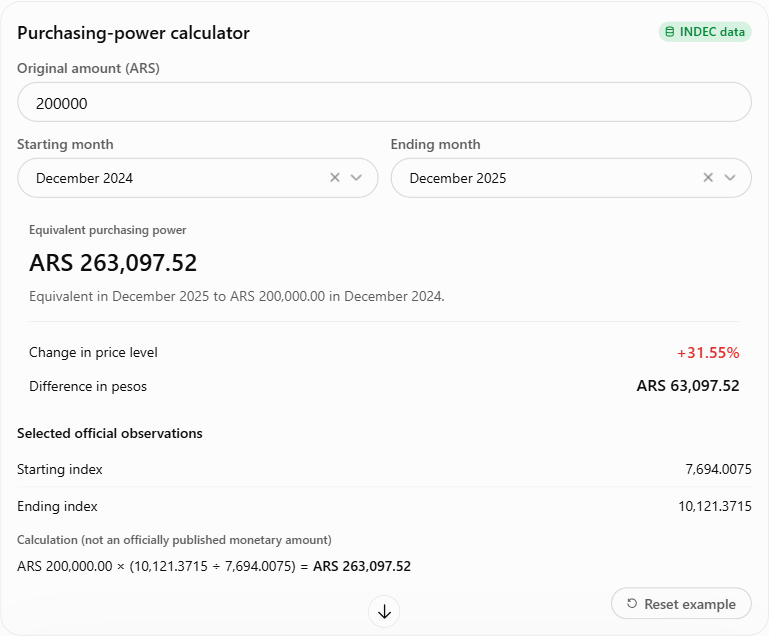
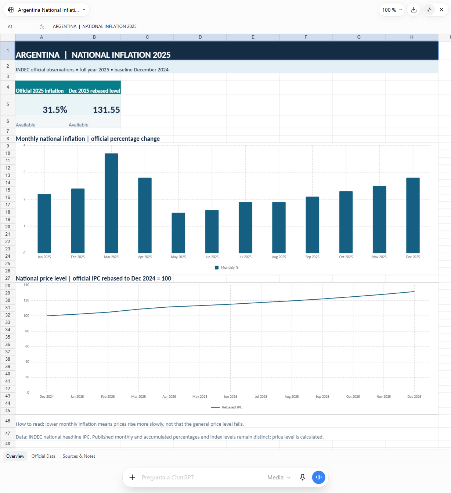

**Proyecto independiente. Sin afiliación ni aval del INDEC.**

[ EN](README.md) · ** ES**

# INDEC MCP

**Estadísticas oficiales de Argentina, en tu chat.** Consultá inflación, salarios, canastas básicas, desocupación y actividad económica. Obtené cifras con períodos de referencia y fuentes oficiales, y convertí los resultados en gráficos, comparaciones o archivos descargables.

**v0.1.0 · Acceso privado probado; aprobación en el directorio público pendiente.** [Estado de acceso y despliegue →](docs/DEPLOYMENT.md) (en inglés)

## Probalo en ChatGPT

Una vez conectado, seleccioná **INDEC MCP** desde el menú de apps o escribí `@INDEC` y elegilo. Copiá una consulta de abajo y reemplazá los montos y las fechas por los tuyos.

### Calculá el poder adquisitivo

> Usá INDEC MCP para crear una calculadora interactiva de poder adquisitivo. Empezá con ARS 200000, de diciembre de 2024 a diciembre de 2025. Usá niveles oficiales del IPC nacional: monto * índice final / índice inicial. Permití cambiar el monto y los meses. Mostrá las fechas elegidas y la fuente oficial. Dejá los datos faltantes como no disponibles; aceptá cero como válido. Respondé en español.

**Después:** “Exportá una calculadora de Excel editable con ARS 200000, de diciembre de 2024 a diciembre de 2025. Incluí fórmulas, índices originales y fuentes. Dejá los datos faltantes y los resultados que dependan de ellos como no disponibles.” Repetí los valores elegidos al exportar.

### Convertí la inflación en gráficos y Excel

> Usá INDEC MCP para crear un Excel descargable con la inflación nacional de Argentina de los 12 meses de 2025. Incluí tasas mensuales y acumuladas oficiales, enlaces a las fuentes y un gráfico de barras mensual. Agregá un gráfico del nivel de precios con base diciembre de 2024 = 100 usando índices oficiales del IPC, sin encadenar tasas redondeadas. Identificá los valores calculados y dejá los datos faltantes y los resultados que dependan de ellos como no disponibles. Respondé en español.

Ejemplos reales probados en ChatGPT el 3 de noviembre de 2026. Los gráficos, controles interactivos y archivos descargables dependen de las funciones de tu chat. Si no hay controles disponibles, pedí una tabla o un Excel. Las capturas conservan el idioma de la respuesta original.

¿Te interesa crear con IA? Contactame: albertcapacitaciondigital@gmail.com

## Más consultas para copiar

| Para… | Preguntá… |
| --- | --- |
| Entender la última inflación | Usá INDEC MCP. ¿Cuál es la última inflación mensual disponible en Argentina? Explicala con un ejemplo en pesos. Indicá el mes de referencia y la fuente oficial. |
| Comparar salarios e inflación | Usá INDEC MCP para comparar el aumento salarial del sector público con la inflación nacional en el último período anual coincidente. Mostrá el cambio salarial real separado de la diferencia en puntos porcentuales, con fechas y fuentes. |
| Obtener un resumen económico | Usá INDEC MCP para resumir los últimos datos de inflación, salarios, canastas básicas alimentaria y total, desocupación y actividad económica. Indicá el período, las unidades, la cobertura y la fuente oficial de cada indicador. Señalá los datos no disponibles. |

**Revisá el período, las unidades y la cobertura antes de compartir.** El último dato disponible puede corresponder a un mes o trimestre anterior. Distinguí las observaciones oficiales de los cálculos y revisá los archivos descargados.

[Nueve flujos paso a paso en español](docs/START_HERE.es.md) · [Instalación y desarrollo](docs/DEVELOPMENT.md) · [Herramientas disponibles](docs/TOOL_CONTRACT.md) · [Seguridad](SECURITY.md) · [Privacidad](docs/PRIVACY.md) — el resto de la documentación está en inglés.

**Ayudanos a mejorar la primera versión:** [abrí un issue](https://github.com/albertcapacitacion/indecmcp/issues/new) con tu consulta, el resultado esperado y lo que ocurrió. Quitá los datos personales y las credenciales.

Proyecto independiente de código abierto · [Apache-2.0](LICENSE) · Usa [datos oficiales del INDEC](https://api.indec.gob.ar/); no es un producto del INDEC ni cuenta con su aval.
