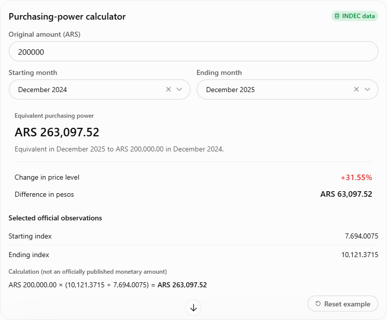
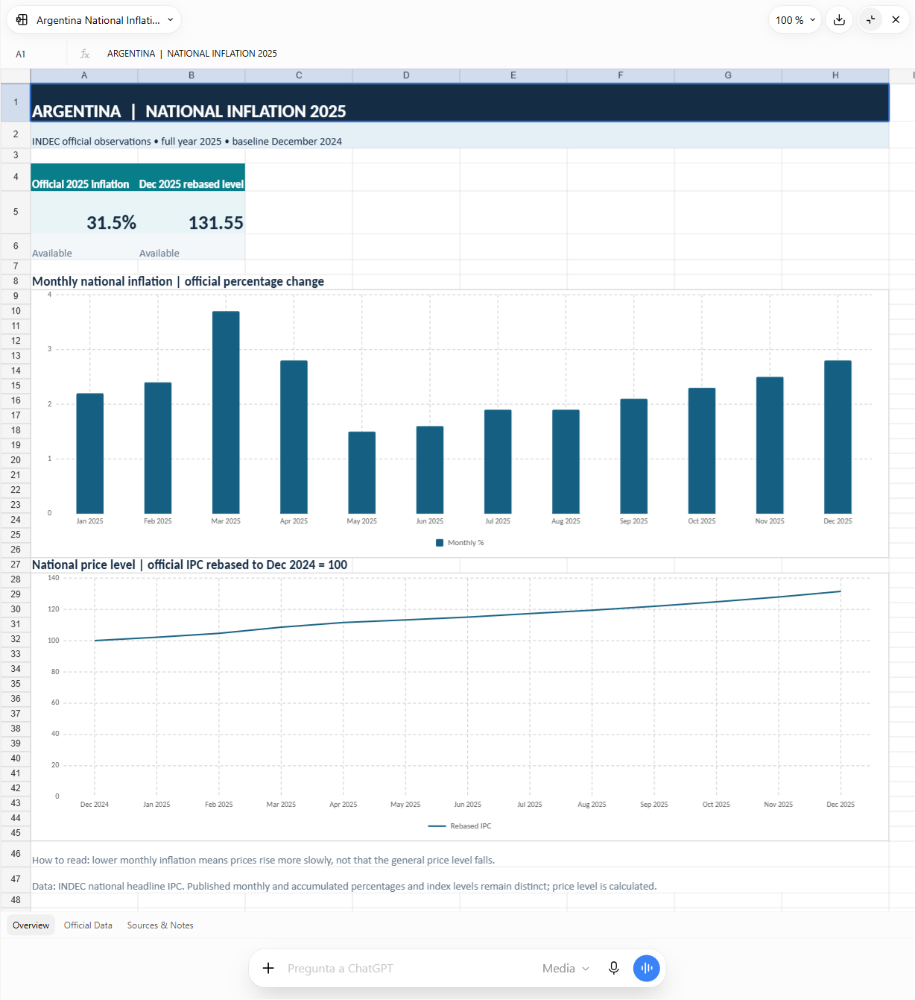

**Independent project. Not affiliated with or endorsed by INDEC.**

** EN** · [ ES](README.es.md)

# INDEC MCP

**Official Argentine statistics, in your chat.** Ask about inflation, wages, basic baskets, unemployment and economic activity. Get figures with reference periods and official sources, then turn them into charts, comparisons or downloadable files.

**v0.1.0 · Private access tested; public directory approval pending.** [Access and deployment status →](docs/DEPLOYMENT.md)

## Try it in ChatGPT

Once connected, select **INDEC MCP** from the apps menu or type `@INDEC` and choose it. Copy a prompt below and replace the amounts and dates with your own.

### Calculate purchasing power

> Use INDEC MCP to create an interactive purchasing-power calculator. Start with ARS 200000, December 2024 to December 2025. Use official national IPC index levels: amount * ending index / starting index. Let me change the amount and months. Show the selected dates and official source. Keep missing inputs unavailable; treat zero as valid. Answer in English.

**Next:** “Export an editable Excel calculator using ARS 200000, December 2024 to December 2025. Include formulas, original index data and sources. Keep missing inputs and dependent results unavailable.” Repeat your chosen inputs when exporting.

### Turn inflation data into charts and Excel

> Use INDEC MCP to create a downloadable Excel workbook with Argentina's national inflation for all 12 months of 2025. Include monthly and official accumulated rates, source links and a monthly bar chart. Add a price-level chart rebased to December 2024 = 100 using official IPC index levels, not chained rounded rates. Label calculated values and keep missing inputs and dependent results unavailable. Answer in English.

Real ChatGPT examples tested on November 3, 2026. Charts, interactive controls and file exports depend on your chat's capabilities. If controls are unavailable, ask for a table or Excel file. Screenshots use the original response language.

## More prompts to copy

| Want to… | Ask… |
| --- | --- |
| Understand the latest inflation | Use INDEC MCP. What is the latest available monthly inflation in Argentina? Explain it with an example in pesos. Show the reference month and official source. |
| Compare wages with inflation | Use INDEC MCP to compare public-sector wage growth with national inflation over the latest matching annual period. Show real wage change separately from the percentage-point gap, with dates and sources. |
| Get an economic briefing | Use INDEC MCP to summarize the latest inflation, wages, basic food and total baskets, unemployment and economic activity. Show each indicator's reference period, units, coverage and official source. Flag unavailable figures. |

**Check the period, units and coverage before sharing.** Latest available data may describe an earlier month or quarter. Keep official observations separate from calculations and check downloaded files.

[Nine step-by-step workflows](docs/START_HERE.md) · [Setup and development](docs/DEVELOPMENT.md) · [Supported tools](docs/TOOL_CONTRACT.md) · [Security](SECURITY.md) · [Privacy](docs/PRIVACY.md)

**Help improve the first version:** [open an issue](https://github.com/albertcapacitacion/indecmcp/issues/new) with your prompt, expected result and what happened. Remove personal information and credentials.

Independent open-source project · [Apache-2.0](LICENSE) · Uses [official INDEC data](https://api.indec.gob.ar/); not an INDEC product or endorsement.
